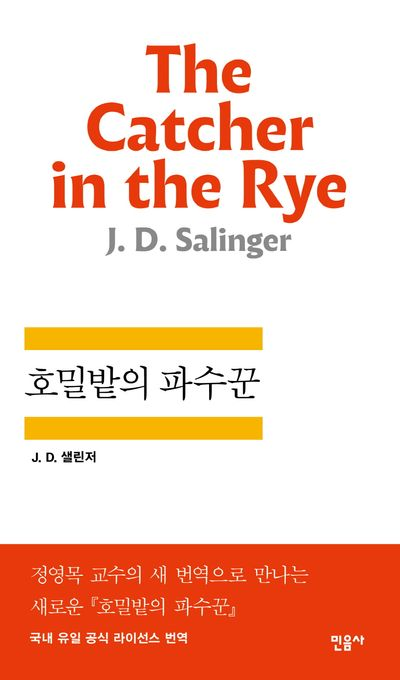

별점: ★★★★☆ (4/5)

평가: 솔직히 엄청 깊은 내용을 다룬다거나, 문장이 인상깊거나 그렇지는 않다. 하지만 책 특유의 몰입감이 대단하다. 

흔해보일 수 있는 주제인 '방황하는 청소년' 을 다루고 있는데, 주인공 '홀든 콜필드' 의 며칠을 그의 시선으로 다니는 여정이다. 이 여정은 압축적이다. 일상이 정신없기도 하지만, 그의 감정의 요동을 느끼다보면 내 옛날 생각이 나면서 그가 벌이는 터무니없는 사건들에도 마음을 열게 된다.  

책이 주는 깊은 울림은 없었지만, 책을 읽는 도중에는 그의 불안정한 심리가 내게 자연스럽게 스며들었다. 나는 '사춘기'라는 말을 좋아하지 않는다. 그 말이 모든 걸 설명해주는 것처럼 사용하는 '어른'들 때문이다. 그러나 이 책은 내게 정말 사춘기 소년으로서의 체험을 다시금 경험하게 해 주었다. 

그러나 아쉬운 건 영어 원서가 아니고 내가 영미권 독자가 아니어서 학창시절의 분위기, 문장 표현 등이 직관적으로 와닿지 못했다. 그럼에도 별점 4개는 충분히 받을 책이라고 생각한다.
