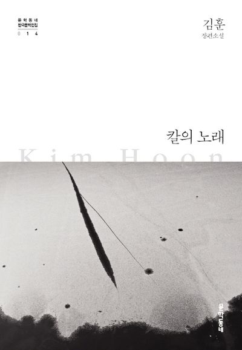

별점: ★★★★☆ (4/5)

평가: 문장 하나하나를 읽으며 감탄한 드문 책이라고 생각한다. 이 책이 명작이라고 평가받는 건 주로 이순신이라는 신격화된 존재를 한 명의 고뇌하는 인간으로 다루는 부분에 있다고 알고 있다. 그러나 우선 나는 이 책의 문장들이 너무 마음에 들었다. 특유의 대비시키는 표현과 모순적인 듯 그렇지 않은 문장들을 보며 감탄했다. 그리고 전쟁을 다루고 있는 책인 만큼 배경 묘사 또한 정말 디테일하고 그 표현들이 아름답다. 책에서 인상깊은 문장을 꼽고 싶지만 그 문장들만 열 개가 넘는다.

이순신이라는 인물을 한 명의 인간으로 그린 것도 당연히 인상깊었다. 인간적이라는 말은 보편적인 도덕성을 지닌 '사람 이순신' 과 왜군을 물리칠 의무를 가진 '장수 이순신'의 대비를 함축한다. 이 치열한 고뇌를 보고 있으면 이순신을 단순히 존경하는 게 아니라 그에게 공감하게 된다. (물론 실제 이순신과는 다를 수 있지만 이는 소설로서는 무방하다.)

그러나 각 장마다 독립된 장처럼 느껴져서 서사의 연속성이 강하게 느껴지지 않은 점, 그만큼 책이 술술 읽히지 않는 점에서 별점 4점을 부여했다. 개인적으로 소설은 초반에 잘 안 읽히고 읽다보면 바람이 불어주는 배처럼 쭉 읽어나가는 느낌이지만 이 책은 한 쪽마다도 그 치밀한 심리 묘사와 배경을 그리고 있으니 금방 읽히지는 않았다. 

하지만 한글 문장의 유려함과 미묘함, 역사적 인물의 재발굴이라는 측면에서 나에게는 이 책이 예술 작품이라고 생각한다. 한 번에 읽으려 하지 말고 조금씩 꾸준히 읽는 것을 권하고 싶다.
