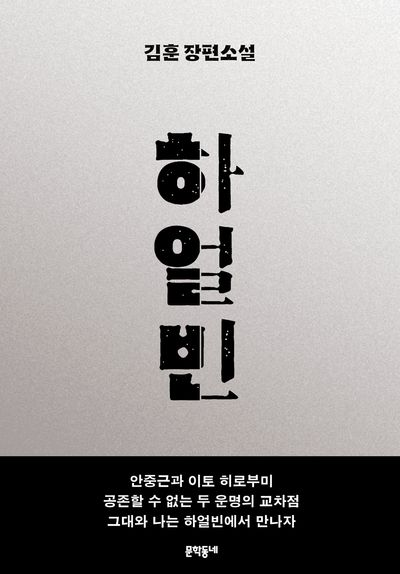

별점: ★★★★☆ (4/5)

평가: 김훈 작가의 '칼의 노래'를 읽고 이 작품을 읽어서 그런지 처음 읽을 때는 문장이 너무 밋밋하고 그냥 책이 '후루룩' 넘어갔다. 읽은 후에도 큰 감흥이 있지 않았다. 이상하다 싶어 길지 않은 작품이기에 한 번 더 읽었다. 그랬더니 담백한 음식같은 느낌으로 책에 대한 인상이 바뀌었다.

이 책은 독특한 서사 구조를 취한다. 안중근, 빌렘 신부, 이토 히로부미 이렇게 세 사람의 입장에서 이야기가 전개되며 그 시선이 교차된다. 영화같은 관점으로도 보인다. 읽다보면 안중근을 영웅으로 대할 생각이 없는 게 보인다. 안중근의 활약상을 보고 싶다는 마음은 빌렘 신부의 종교적 설득에서 한 번 좌절되고, 이토의 논리적인 말에서 다시금 좌절된다. 이들을 뿌리치고 나면 드디어 안중근의 암살 장면이 나오는데, 전혀 극적이지 않다. 조용한 분위기에서 적막이 느껴진다. 경찰이 뛰어오고, 사람들은 웅성거리고, 그 속에서 "코레아 우라" 를 외치는 안중근의 모습은 심지어 초라해보인다.

이 과정 속에서 문체는 '칼의 노래'와는 달리 군더더기가 없다. 필요한 말만 하는 느낌이다. 이건 다른 느낌으로 좋다. 뭐라고 말은 못하지만 여운이 오래 가는 이야기를 한 편 들은 느낌이랄까. 이 책을 꾸밀 미사여구는 마땅히 못 찾겠지만 좋았던 책이다.
