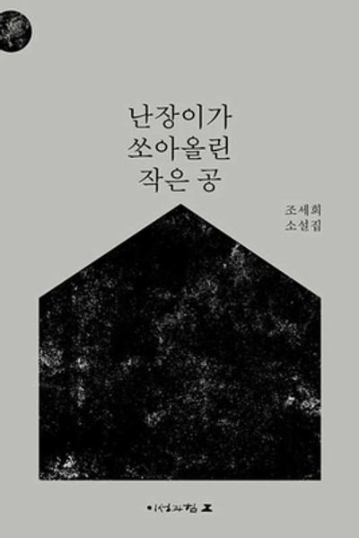

별점: ★★★☆☆ (3/5)

평가: 시대적 명작이라서 찾아 읽었다. 공장지대의 매연, 등장인물의 대비적 시선을 통한 빈부격차와 그 당시 환경의 묘사 등 탁월하다고 생각되는 요소가 많았다. 특히 노동자들의 집단파업과 법정다툼 등을 다룬 구체적인 모습 등이 기억이 난다. 

하지만 내가 연작 소설을 별로 좋아하지 않는 것 같기도 하다. 그래서 그런지 나는 당시의 시대를 적나라하게 보여준다는 의미 말고 다른 감상은 크게 들지 않았다. 다시 말해 시대성이 주된 감상일 뿐이었다. 탄탄한 서사가 아니라 단편마다 연결된 느슨한 서사라 집중력이 좀 떨어졌고, 이야기가 뭔가 붕 뜬다는 생각을 받았다. 

그렇지만 당시 시대를 체험할 수 있게 해준다는 면에서 한 번 읽을 만한 책은 맞다고 생각한다.
