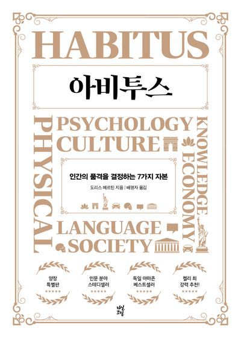

평점: ★★☆☆☆ (2/5) ~ ★★★☆☆ (3/5)

평가: 나쁜 책은 아닌데, 그렇다고 읽어서 엄청 유의미한 책은 또 아니라고 생각한다. 그렇지만 별점을 최대 3점까지 줄 수 있다고 생각하는 이유는 암묵적인 '계급' 을 인정하는 태도를 기를 수 있어서이다.

나는 어릴 때부터 계급적으로 나눠져있는, '불평등해 보이는' 것들을 싫어했다. 하지만 점점 나이가 들수록 불평등은 만연하다는 것이 보이기 시작했다. 아직도 숨겨진 차별에 익숙하지는 않지만 이런 책을 통해 어떤 요소들이 그것에 기여하는지 혹은 나타내는지 알 수 있다는 점에 의의가 있다고 생각한다. 

하지만 나에게는 모든 자기계발서의 내용이 빨리 휘발되는데, 이 책 역시 크게 다르지 않았다는 점에서 높은 별점을 줄 수는 없었다.
