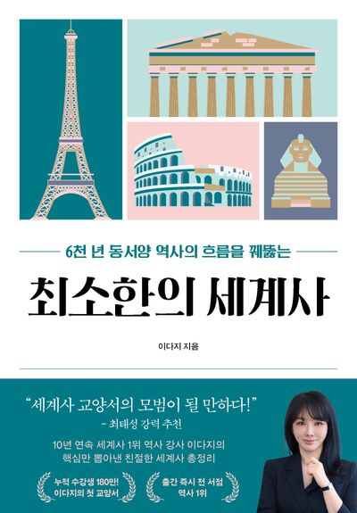

평점: ★★★☆☆ (3/5) ~ ★★★★☆ (4/5)

평가: 무난하게 좋은 책이었다. 나는 고등학교 1학년까지 역사 수업을 열심히 들었지만 이과를 선택해서 역사를 잘 알지 못했다. 특히 서양사에 대한 지식은 중학교 때 들은 수업이 다였지만 그것마저 거의 기억에서 날아가 있었다.

그러 여러 책을 읽으며 교양에 대한 욕심이 생기고 그 교양은 역사로부터 시작한다고 생각했다. 바로 역사 전공서 『서양사 강좌』를 구매했으나 잘 읽히지 않았다. 그래서 잠시 그 책을 내려놓고 먼저 읽 역사 교양서로 이 책을 골랐는데, 충분히 훌륭한 역할을 했다고 생각한다. 

당연히 중간에 건너뛰는 부분도 많이 느껴지고 설명이 엄청 자세하지는 않았지만 세계사 체험판 같은 느낌으로 좋은 책이었다. 이 책을 읽은 이후 『서양사 강좌』를 읽고 있는데 확실히 좀 부드럽게 읽힌다. 역사 공부의 시발점이 되는 책이라고 할 수 있겠다.
